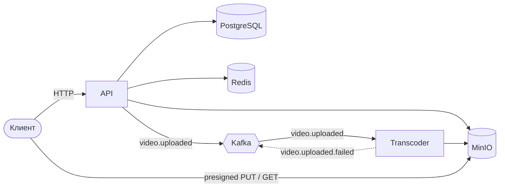
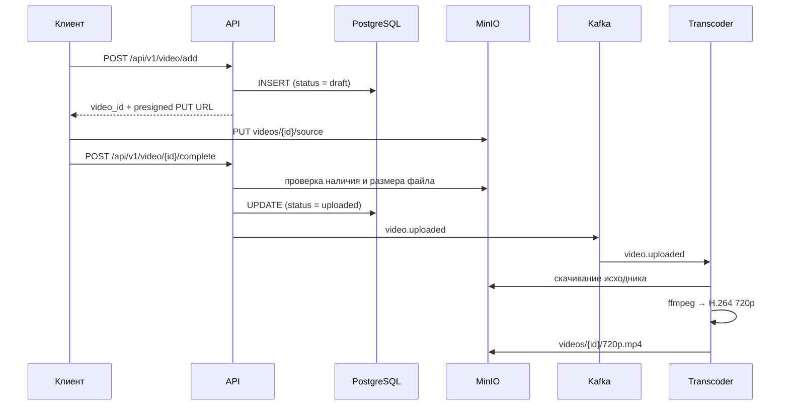
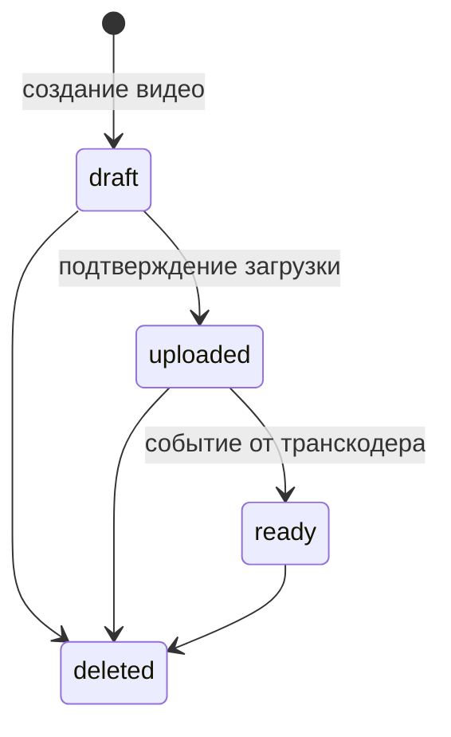

# Go VideoHosting

Бэкенд видеохостинга на Go из двух сервисов. Файлы загружаются в S3-совместимое хранилище напрямую по presigned-ссылкам, минуя API, а перекодирование выполняется асинхронно: API публикует событие в Kafka, отдельный сервис-транскодер обрабатывает его через ffmpeg.

**Стек:** Go 1.26, chi, PostgreSQL (pgx), Redis, MinIO, Kafka (kafka-go), ffmpeg, goose, Docker Compose.

## Архитектура



**API** отвечает за пользователей, аутентификацию и метаданные видео. Сам файл через него не проходит: API выдаёт presigned-ссылку, клиент загружает видео прямо в MinIO и затем подтверждает загрузку.

**Transcoder** — воркер без HTTP-интерфейса. Он читает события из Kafka, скачивает исходник из MinIO, перекодирует его в 720p и сохраняет результат обратно в хранилище.

Сервисы общаются только через Kafka и ничего не знают о внутреннем устройстве друг друга.

### Принципы

Оба сервиса построены по чистой архитектуре: слои `domain` → `application` → `infrastructure` / `presentation`, зависимости направлены внутрь. Доменный слой не зависит ни от HTTP, ни от базы данных, ни от брокера.

- Агрегаты `User` и `Video` защищают свои инварианты: value objects валидируют данные при создании, смена статуса видео идёт только через машину состояний.
- Восстановление агрегатов из БД выполняется отдельной функцией `Reconstitute`, в обход валидации.
- Интерфейсы (порты) объявляются на стороне потребителя: сервисы приложения зависят от `Repository`, `Storage`, `Publisher`, а не от pgx, MinIO или Kafka.
- Входящие адаптеры (HTTP-хендлеры, обработчики событий) отделены от исходящих (репозитории, хранилище, продюсер).

## Сценарий загрузки видео



### Жизненный цикл видео



Сейчас в работе переходы `draft → uploaded`. Переход `uploaded → ready` предусмотрен в домене, но выставляться будет после того, как API начнёт обрабатывать события транскодера (см. [планы](#ограничения-и-планы)). Статусы `processing` и `failed` заведены в домене и в схеме БД под следующий этап.

## Обработка событий

| Событие | Топик | Публикует | Потребляет | Payload |
|---|---|---|---|---|
| `video.uploaded` | `video.events` | API | Transcoder | `video_id`, `owner_id`, `created_at` |
| `video.uploaded.failed` | `video.events` | Transcoder | — | `video_id`, `created_at` |

Тип события передаётся в заголовке `event_type`, топик выводится из префикса имени (`video.*` → `video.events`). Это позволяет менять раскладку топиков, не трогая маршрутизацию.

На стороне транскодера сообщения обрабатывает собственная шина:

- маршрутизирует сообщения по `event_type` в зарегистрированные обработчики;
- обрабатывает до 10 сообщений параллельно; когда все слоты заняты, чтение из Kafka приостанавливается;
- коммитит оффсет вручную, только после успешной обработки (at-least-once);
- работает идемпотентно: если `720p.mp4` для видео уже есть в хранилище, перекодирование пропускается;
- разделяет ошибки на повторяемые и необрабатываемые: если исходник не найден, публикуется `video.uploaded.failed` и сообщение подтверждается, чтобы не блокировать партицию.

Перекодирование: `ffmpeg` запускается через `exec.CommandContext`, видео сжимается в H.264 (720p, CRF 23), звук в AAC 128 kbit/s, с флагом `faststart` для воспроизведения до полной загрузки. Временные файлы удаляются после обработки.

## Быстрый старт

Нужны Docker с Compose и `jq` для примеров ниже.

```bash
git clone https://github.com/TupichokTheF/Go-VideoHosting.git
cd Go-VideoHosting
cp .env.example .env    # заполните пароли и секреты
```

Presigned-ссылки подписываются для адреса `minio:9000` — так MinIO называется внутри сети Compose. Чтобы клиент на хост-машине мог по ним загружать файлы, добавьте имя в `/etc/hosts` (один раз):

```bash
echo "127.0.0.1 minio" | sudo tee -a /etc/hosts
```

Запуск:

```bash
docker compose up -d --build
```

Compose поднимает PostgreSQL, Redis, MinIO и Kafka, дожидается их готовности по healthcheck, применяет миграции отдельным контейнером `migrate` и затем запускает API и транскодер.

| Сервис | Адрес |
|---|---|
| API | http://localhost:8080 |
| Swagger UI (при `SWAGGER=true`) | http://localhost:8080/swagger/index.html |
| Консоль MinIO | http://localhost:9001 |

### Пример: от регистрации до перекодированного видео

```bash
# Регистрация
curl -s -X POST localhost:8080/api/v1/auth/register \
  -H 'Content-Type: application/json' \
  -d '{"username":"maxim","email":"maxim@mail.ru","password":"Secret1"}'

# Вход: access-токен в теле, refresh-токен в cookie
ACCESS=$(curl -s -X POST localhost:8080/api/v1/auth/login \
  -H 'Content-Type: application/json' \
  -d '{"username":"maxim","password":"Secret1"}' | jq -r .access_token)

# Создание видео: получаем id и ссылку для загрузки
RESP=$(curl -s -X POST localhost:8080/api/v1/video/add \
  -H "Authorization: Bearer $ACCESS" \
  -H 'Content-Type: application/json' \
  -d '{"title":"Котики","description":"Видео про котиков"}')
VIDEO_ID=$(echo "$RESP" | jq -r .video_id)
UPLOAD_URL=$(echo "$RESP" | jq -r .url)

# Загрузка файла напрямую в MinIO
curl -T ./sample.mp4 "$UPLOAD_URL"

# Подтверждение загрузки: API проверяет файл и публикует video.uploaded
curl -X POST "localhost:8080/api/v1/video/$VIDEO_ID/complete" \
  -H "Authorization: Bearer $ACCESS"

# Ссылка на просмотр
curl -s "localhost:8080/api/v1/video/$VIDEO_ID" | jq -r .url
```

За обработкой можно следить через `docker compose logs -f transcoder`. Когда она завершится, в консоли MinIO в бакете `videos` появится объект `videos/<VIDEO_ID>/720p.mp4`.

## API

Все пути начинаются с `/api/v1`.

| Метод | Путь | Доступ | Описание |
|---|---|---|---|
| `POST` | `/auth/register` | — | Регистрация. Тело: `username`, `email`, `password`. Ответ `201`: `user_id` |
| `POST` | `/auth/login` | — | Вход. Тело: `username`, `password`. Ответ: `access_token`, refresh-токен в HttpOnly-cookie `refresh_token` |
| `POST` | `/auth/refresh` | cookie | Новый access-токен по refresh-токену |
| `POST` | `/auth/logout` | cookie | Отзыв refresh-токена |
| `GET` | `/user/me` | Bearer | Профиль: `id`, `username`, `email` |
| `POST` | `/video/add` | Bearer | Создание видео. Тело: `title`, `description`. Ответ: `video_id`, `url` для загрузки (PUT) |
| `POST` | `/video/{video_id}/complete` | Bearer, владелец | Подтверждение загрузки, публикация `video.uploaded` |
| `GET` | `/video/{video_id}` | — | Presigned-ссылка на просмотр |

Ошибки возвращаются в формате `{"error": "..."}`. Ошибки валидации — `400`, неверные учётные данные и токены — `401`, чужое видео — `403`, отсутствующий объект — `404`, занятые имя или email — `409`.

**Правила валидации:** имя пользователя от 4 до 30 символов; пароль от 6 до 30 символов, с заглавной и строчной буквой и цифрой; корректный email; непустой заголовок видео; описание до 1000 символов.

**Аутентификация:** пара JWT-токенов (HS256) с раздельными секретами. Access-токен передаётся в заголовке `Authorization: Bearer`, refresh-токен — в HttpOnly-cookie. При выходе идентификатор refresh-токена (`jti`) заносится в Redis с TTL до истечения токена, после чего токен перестаёт приниматься.

## Конфигурация

Переменные задаются в `.env` в корне репозитория; пример — `.env.example`. Внутри Compose адреса зависимостей (`DB_HOST`, `REDIS_HOST`, `MINIO_HOST`, `KAFKA_HOST`) и группы консьюмеров переопределяются в `docker-compose.yml`.

| Переменная | По умолчанию | Сервис | Назначение |
|---|---|---|---|
| `HTTP_HOST`, `HTTP_PORT` | — | API | Адрес HTTP-сервера; Compose публикует порт `8080` |
| `DB_HOST`, `DB_PORT`, `DB_USER`, `DB_PASSWORD`, `DB_NAME` | — | API | PostgreSQL |
| `REDIS_HOST`, `REDIS_PORT` | — | API | Redis |
| `ACCESS_SECRET_KEY`, `REFRESH_SECRET_KEY` | — | API | Секреты подписи JWT |
| `ACCESS_TOKEN_TTL`, `REFRESH_TOKEN_TTL` | — | API | Время жизни токенов, например `15m`, `168h` |
| `SWAGGER` | `false` | API | Включает Swagger UI |
| `MINIO_HOST`, `MINIO_PORT` | `localhost`, `9000` | оба | Адрес MinIO |
| `MINIO_USER`, `MINIO_PASSWORD` | — | оба | Учётные данные MinIO (пароль не короче 8 символов) |
| `MINIO_BUCKET` | `videos` | оба | Бакет; API создаёт его при старте |
| `MINIO_TTL` | `30m` | API | Время жизни presigned-ссылок |
| `KAFKA_HOST`, `KAFKA_PORT` | `localhost`, `9092` | оба | Адрес брокера |
| `KAFKA_TOPICS` | `video.events` | оба | Топики для чтения |
| `KAFKA_GROUP_ID` | `transcoding` | оба | Группа консьюмеров; в Compose у каждого сервиса своя |
| `TRANSCODER_BIN` | `/usr/bin/ffmpeg` | Transcoder | Путь к ffmpeg |

`DB_PORT`, `REDIS_PORT` и `MINIO_PORT` используются и для публикации портов на хост, и для подключения сервисов внутри сети Compose, поэтому должны совпадать со стандартными портами: `5432`, `6379` и `9000`.

## Структура репозитория

```
.
├── docker-compose.yml
├── go.work                        # Go workspace: api + transcoder
└── services
    ├── api
    │   ├── cmd
    │   │   ├── api                # HTTP-сервер
    │   │   └── migrate            # миграции goose, SQL вшит в бинарник через embed
    │   ├── migrations
    │   └── internal
    │       ├── domain             # агрегаты User и Video, value objects, доменные события
    │       ├── application        # сценарии использования, DTO, порты
    │       ├── infrastructure     # PostgreSQL, Redis, MinIO, Kafka, JWT, bcrypt
    │       └── presentation
    │           ├── http           # роутеры chi, хендлеры, схемы, мапперы, middleware
    │           └── events         # шина сообщений для входящих событий
    └── transcoder
        ├── cmd/worker
        └── internal
            ├── application        # сценарий перекодирования, порты Storage и Transcoder
            ├── infrastructure     # MinIO, ffmpeg, Kafka
            └── presentation
                ├── messaging      # шина: маршрутизация, параллелизм, коммит оффсетов
                └── handlers       # обработчик video.uploaded
```

Каждый сервис — отдельный Go-модуль со своим `go.mod` и Dockerfile. Образы собираются в два этапа: статически слинкованный бинарник копируется в минимальный образ Alpine (для транскодера — вместе с ffmpeg).
- **Публичный адрес хранилища.** Presigned-ссылки подписываются для внутреннего адреса MinIO; планируется отдельный публичный endpoint вместо записи в `/etc/hosts`.